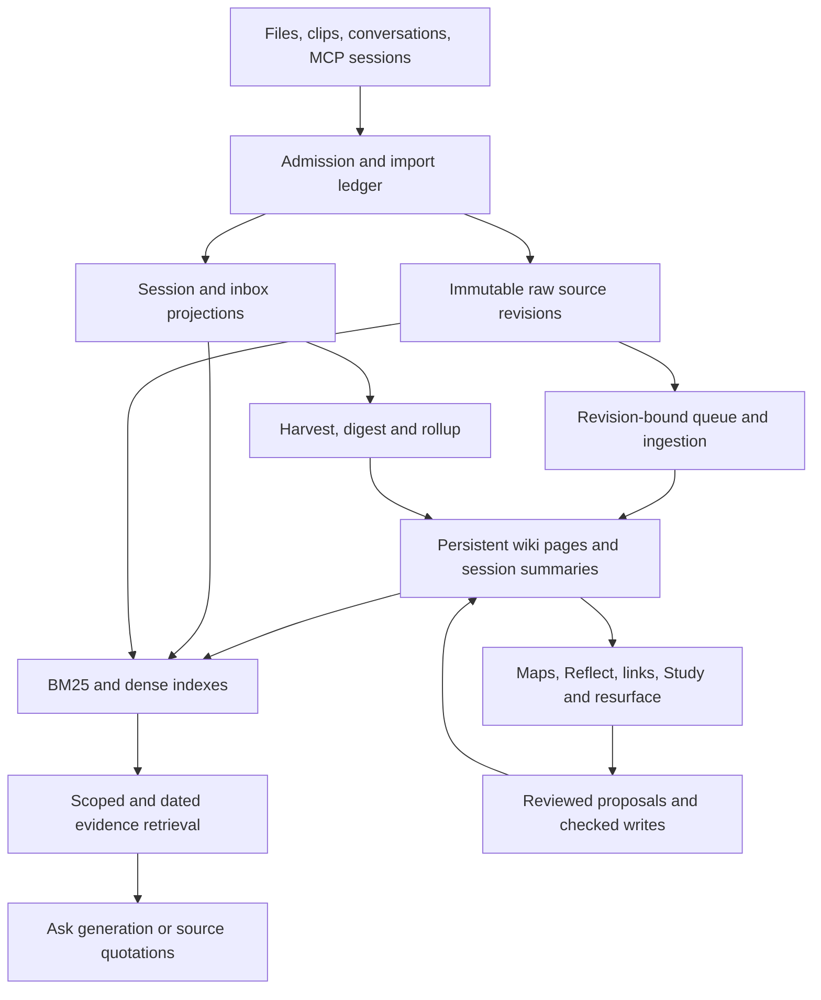

# LLM wiki audit and model evaluation plan — 2026-10-08

**Decision:** repair the shared storage, execution and evidence contracts before
selecting a replacement model. Evaluate on-device generators for Ask/session
compilation and EmbeddingGemma 2 for retrieval as separate changes. Core features
and acceptance must not require a paid API, external account or connected CLI.
The current Qwen 4B and the tested 9B have not passed the recent-work/advice
semantic checks. A valid citation ID is not proof that a claim is true.

The user's local-first direction supersedes the earlier connected-generator
recommendation. External models remain optional research candidates: they run
only after the user connects and explicitly selects the relevant route. Local
failure must not trigger cloud inference or a paid judge automatically.

See the [execution companion](../specs/2026-10-08-llm-wiki-model-and-validation-plan.md)
for per-feature model routes, frozen evaluation splits, acceptance gates and the
later Goal handoff.

This is a review and proposed backlog, not an implementation receipt. No user
vault, installed application, provider selection, model weights or production
settings were changed. Source baseline: `a1023223ca5914b71e7bc9ccd00a780fa978fa5f`,
myco 0.4.0. Research was checked on October 8, 2026. The review host has 16 GiB
unified memory and an ARM64 Mac. No newly researched candidate was benchmarked
in this audit; prior Qwen replay measurements are reported separately.

## Scope and evidence boundary

The review traced desktop and native storage, MCP import/write paths, session
identity/revisions, lexical and dense indexing, retrieval, Ask, Agent, ingestion,
harvest, distill, digests/rollups, topic maps, Reflect, suggested links, provenance,
Study, resurfacing and scheduling. Standalone Python ingestion/digest automation
was inspected separately because it does not inherit desktop guards.

Findings below distinguish executed synthetic reproductions, confirmed code
paths, architectural risks and prior model observations. This was not exhaustive
testing of every handler, operating system, provider or crash interleaving.
No private source excerpts or session identifiers are included here.

The last installed-app observation showed an empty note list while source files
remained on disk. This audit reproduced error swallowing in a synthetic folder;
it did not prove the installed incident's macOS permission cause or establish
that its saved index was actually pruned.

## Current feature flow

This is already a persistent wiki, rather than just a document chat UI. The
problem is inconsistent guarantees between its entry points and between source
preservation, generated summaries and final answers.

| Feature | Actual implementation and boundary |
| --- | --- |
| File storage/editor | Markdown is the source of truth. Native atomic replacement exists; editor writes are serialized in process. General editor saves do not require a baseline revision and failed drafts remain only in memory. |
| MCP/session import | Stable `session_key`, immutable source revisions, canonical summary path, separate human/generated titles and revision-checked queue completion exist. Explicit MCP imports enqueue compilation; unattended sweeps remain archive-only. |
| Search/index | Bundled E5 KO/EN embeddings plus BM25 and RRF; scope, date, phrase and current chunk checks. Dense model/signature mismatch rejects stale geometry; lexical fallback remains. |
| Ask | Selected local 2B/4B generators are optional. Local synthesis has source hash and JSON/ID guards. External providers return prose through a different path. Period-specific activity and undated activity take different routes. |
| Harvest | Deterministic duplicate/junk/size filtering and embedding-based link candidates; user-selected sessions are copied to the inbox and ingested in bounded batches. It is not an LLM deciding every harvest candidate. |
| Distill | Provenance/ontology admission, quarantine/TTL/proposals, session digests, weekly/monthly rollups, full-tier ingestion, maps and resurfacing. Original raw sources are not moved by the retired raw-distill operation. |
| Digest/rollup | Quotes and coverage receipts are preserved before revision-checked archiving. A local preview reads at most six selected chunks; full quoted coverage does not mean the prose summarized every quote. |
| Topic maps | Generated member links are checked against an allowlist. Complete member bodies/revisions and evidence for descriptions are not required; an existing map is returned without incorporating new members. |
| Reflect/lint | Built-in Reflect analyzes graph orphans/unresolved links; built-in lint is a deterministic checklist. Selecting Qwen for Ask does not make these paths a semantic LLM audit. Connected providers can generate prose, without complete file-coverage guarantees. |
| Suggested links/provenance | Link suggestions use embedding similarity and reviewed CAS application. Provenance scans citations and statuses; the contradiction queue uses `disputed`/`superseded` metadata and links, rather than universally detecting conflicting claims. |
| Study/resurface/tasks | Default cards/quizzes are extractive and FSRS scheduled. Opt-in generated study content has quotation checks. Resurface uses daily seeds and dormant-note cosine; tasks parse Markdown/recurrences and expose manual agent presets. These do not train a model or autonomously execute every unfinished task. |

Entry-point evidence:
[harvest](../../src-tauri/src/harvest.rs#L105),
[session compilation](../../src/lib/fullTierIngest.ts#L112),
[MCP queue policy](../../src-tauri/src/mcp_native.rs#L4055),
[Reflect](../../src/stores/reflectStore.ts#L199),
[contradiction queue](../../src/lib/contradictions.ts#L23),
[Study](../../src/lib/study.ts#L192).

## Findings that should block broader automatic operation

### F01 — P0: unreadable is treated as empty/deleted

`vault_entries` converts `read_dir` failure to an empty list and drops entry
errors. `list_files` can therefore return success with no notes. Both full
reindex paths treat an incomplete collection as the complete set of present
files, prune missing dense/BM25 records and save. Incremental deletion detection
also uses a boolean file check that does not distinguish a stat failure.

**Executed reproduction:** extracted production traversal functions on a
synthetic folder returned `list_files=Ok([])` when `read_dir=PermissionDenied`.
This confirms the traversal bug, not the installed application's permission
diagnosis. Index pruning was traced in code, not performed on the real vault.

Use an explicit complete/partial/unreadable scan result. Prune only on a complete
scan or a confirmed deletion; retain the last healthy index for the same vault
and show recovery actions on read failure.
[Traversal](../../src-tauri/src/vault.rs#L255),
[collection](../../src-tauri/src/commands.rs#L4363),
[manual prune](../../src-tauri/src/commands.rs#L4823),
[automatic reconcile](../../src-tauri/src/index_updater.rs#L490).

### F02 — P0: legacy MCP paths bypass source/path protection

Deprecated `create_page`/`update_page` remain callable. Their lexical helper and
direct writer bypass the canonical confinement and checked draft protections of
the newer writer. A directory symlink under `wiki/` can direct an update into
immutable `raw/`, or outside the vault.

**Executed reproduction:** production helper/writer functions, extracted into an
isolated Rust harness, overwrote a synthetic raw file through a wiki symlink.
MCP transport/dispatch was not exercised, and no actual source was touched.
Route legacy aliases through the same checked path; audit all public mutation
and read entry points for the same canonical boundary.
[Path helper](../../src-tauri/src/mcp_native.rs#L344),
[legacy update](../../src-tauri/src/mcp_native.rs#L1720),
[writer](../../src-tauri/src/vault.rs#L1278).

### F03 — P0: Agent and Reflect actions can target a different vault

Agent confirmation previews use the originating vault, but the tool IPC carries
no origin vault/opening token. Native dispatch resolves the currently active
vault. Reflect similarly retains suggestions from one vault and applies them
using the current vault's `openWikilink`.

**Executed synthetic IO reproductions:** a vault switch during Agent approval
dispatched a write without origin identity; an A-vault Reflect suggestion invoked
B-vault creation and reported success. Production TS functions were used with
mocked IO; no native/user file write occurred.

Bind runs, results and every tool call to origin vault plus opening generation.
Revalidate at native dispatch, after approval and before each mutation. A switch,
close or same-path reopen must invalidate the old capability.
[Agent loop](../../src/lib/agentLoop.ts#L140),
[native dispatch](../../src-tauri/src/commands.rs#L4090),
[Reflect apply](../../src/stores/reflectStore.ts#L262).

### F04 — P0 quality gate: evidence existence is confused with answer correctness

Local validation checks JSON, length, language, allowed source IDs and link
shape. It does not establish claim-level entailment, the subject/actor, event
time or whether a historical request/report establishes current completion.
External Ask prose does not receive even the same common citation contract.

Prior exact-prompt 4B and 9B runs completed structural validation but failed
semantic review: historical uncertainty became current status, instructions
leaked into summaries, and a discussed project lacked the relevant citation.
This is observed model behavior, not just a hypothetical risk.
[Validator](../../src-tauri/src/local_synthesis.rs#L606),
[external answer publication](../../src/stores/queryStore.ts#L628),
[actual replay observations](2026-10-07-recent-activity-verification.md#compiled-session-context-correction--october-8).

Use a common bounded claim/evidence contract for compilation and all Ask
providers. Preserve actor, event date, request/plan/report/verification/retraction
and unresolved status. Validate identifiers/revisions/dates deterministically;
evaluate entailment and usefulness separately. Historical unknown status must
remain unknown today unless later evidence resolves it. Model judging can help
triage, but must not be described as proof or replace reviewed release cases.

## Further confirmed gaps and risks

| ID / priority | Finding and evidence | Required work |
| --- | --- | --- |
| F05 / P1 | Editor whole-file saves lack baseline CAS; checked MCP hash is optional. Agent approval also does not bind the previewed revision. [Editor](../../src/stores/vaultStore.ts#L419), [MCP](../../src-tauri/src/mcp_native.rs#L3488), [Agent](../../src-tauri/src/agent_tools.rs#L195). | Make expected revision mandatory for updates, preserve both edits on conflict, and show a conflict/recovery action. |
| F06 / P1 | Session/inbox projections are editable but reimport replaces them using direct `fs::write`; manual annotations can disappear. [Import](../../src-tauri/src/commands.rs#L2158), [Reader](../../src/pages/PageReader.tsx#L1095). | Define projection ownership. Preserve human notes in owned sections or a separate annotation file; use atomic replacement. |
| F07 / P1 risk | Import ledger direct writes, unreadable/corrupt-as-empty loads, ignored save failure and unlocked clipper load/save allow duplicate/reconciliation and lost-update problems. Concurrent production loss was not reproduced. [Ledger](../../src-tauri/src/importers/ledger.rs#L153), [save](../../src-tauri/src/importers/ledger.rs#L346), [clip](../../src-tauri/src/clip.rs#L275). | Share a writer lock, publish atomically, surface failure and quarantine/recover corrupt ledgers instead of resetting identity. |
| F08 / P1 | Auto import hides failures/quarantine; unattended sweeps do not enter the canonical wiki queue. The explicit MCP revision queue is already implemented. [Auto import](../../src/lib/autoImport.ts#L55), [queue policy](../../src-tauri/src/mcp_native.rs#L4055). | State which arrivals are archived versus compiled. When automatic organization is enabled, queue every admitted new revision with bounded costs, retry and an exact completion receipt. |
| F09 / P1 | Dated activity overview uses transcript-only temporal recall; Wiki scope excludes those transcripts, so a dated “my notes” work summary can be empty despite compiled wiki evidence. [Branch](../../src/stores/queryStore.ts#L519), [temporal filter](../../src-tauri/src/temporal_recall.rs#L96), [Wiki scope](../../src-tauri/src/retrieval.rs#L1080). | Unify dated/undated activity evidence and synthesis while retaining the explicit scope. Do not fix this by silently broadening the user's scope. |
| F10 / P1 | Read-only Ask/Reflect/lint use the write-capable CLI runner. Claude allows edits; Codex uses workspace-write; Gemini uses yolo/skip-trust. Codex/Gemini direct file tools bypass app raw/CAS guards. No actual injection/unauthorized mutation was observed. [Chat dispatch](../../src/lib/chat.ts#L247), [Claude](../../src-tauri/src/claude.rs#L99), [CLI arguments](../../src-tauri/src/cli_agent.rs#L100). | Pass execution capability to native runners. Enforce read-only for questions; stage ingest changes and validate original hashes/diffs before publishing. |
| F11 / P1 | Digest/rollup IO errors and several distill substep errors become no-error/null results, allowing `done`. Manual ingest can continue after validator IPC failure. Auto Reflect records the revision before success; lock-busy Distill can consume cooldown. [Digest](../../src/lib/sessionDigest.ts#L226), [orchestrator](../../src/lib/distill.ts#L531), [manual validator](../../src/stores/ingestStore.ts#L840), [Reflect tick](../../src/lib/autoReflect.ts#L33). | Persist step/item outcomes: success, partial, failed, stopped, skipped. Validation unavailable must remain pending. Advance success watermarks only after success and retry failed steps explicitly. |
| F12 / P1 | Draft maps can become ontology anchors without approval checks. Percentiles are calculated against the old centroid and are not recalculated after an anchor replaces it. Cache reuse uses model and page count, missing same-count content/status changes. [Anchor reader](../../src-tauri/src/distill.rs#L2793), [centroid replacement](../../src-tauri/src/ontology.rs#L339), [cache](../../src-tauri/src/distill.rs#L2879). | Use approved anchors only; calculate thresholds in the chosen geometry. Key ontology reuse to index/content generation and approval state. |
| F13 / P1 | Cloud/CLI digest prose receives format checks; local previews additionally check source-link consistency. Neither establishes claim support. MOC prompts list stems and may receive generic retrieval/CLI reads, but do not ensure all approved member revisions. Existing maps do not refresh. [Preview](../../src/lib/sessionDigest.ts#L127), [local preview](../../src/lib/localTransform.ts#L64), [map](../../src/lib/maps.ts#L171). | Apply the common claim contract; map-specific member evidence and refresh must preserve human annotations. Quote coverage and prose coverage should be reported separately. |
| F14 / P1 risk | Manual and automatic reindex load independent snapshots and save the same index files; last writer wins. New absent trees are not watched until rebind. Actual concurrent loss was not reproduced. [Manual](../../src-tauri/src/commands.rs#L4704), [actor](../../src-tauri/src/index_updater.rs#L451), [store contract](../../src-tauri/src/vector_index.rs#L162), [watch](../../src-tauri/src/index_updater.rs#L372). | One index publisher per vault, shared generation for lexical/dense stores, crash recovery and watch topology updates. |
| F15 / P1 | Standalone Python automation uses file-count/total-size as success, and unlinks its new raw source after partial failure without undoing wiki writes. It also lacks the desktop raw deny argument. [Runner](../../../automation/autoingest.py#L123), [success/rollback](../../../automation/autoingest.py#L212). | Bring automation onto the checked pipeline or explicitly deprecate its unsupported behavior. Preserve raw backing partial writes; track a file hash/diff manifest and recover safely. |
| F16 / P1–P2 | Remaining synchronous Git IPC/uncancelled child processes can repeat earlier UI blocking. Commit staging can include already-staged unrelated files; undo uses second-resolution mtime; failed editor drafts are not restart durable. [Git IPC](../../src-tauri/src/commands.rs#L3368), [commit](../../src-tauri/src/vault_history.rs#L88), [undo](../../src-tauri/src/distill.rs#L3111), [drafts](../../src/stores/vaultStore.ts#L78). | Move blocking work off the UI thread, isolate commit paths and preserve the user's index/identity, hash-bind undo, and add local draft recovery. |
| F17 / P2 | Activity recall caps body reads at 64 pages/8 MiB and final evidence at 12 chunks; 4096-token context can drop groups. Query-block phrase search caps at 1000 files; cache keys omit content revision and can remain stale while tree/adjacency objects are unchanged. Agent `list_pages` uses outgoing-link keys, missing unlinked pages. [Activity](../../src-tauri/src/activity_recall.rs#L145), [budget](../../src-tauri/src/local_synthesis.rs#L390), [query cache](../../src/lib/queryLoad.ts#L95), [agent inventory](../../src-tauri/src/agent_tools.rs#L168). | Measure project/time coverage; use the actual page inventory, revision-key caches and bounded hierarchical recall instead of implying complete corpus review. |
| F18 / P2 | Generated quiz relationships/answer options are not semantically checked. Resurface acceptance can count repeated opens and calibration keys lack model identity. [Study](../../src/lib/study.ts#L192), [resurface](../../src/stores/resurfaceStore.ts#L232). | Add answer-grounded study cases, impression-level dedup and model-specific calibration. These are secondary to storage and Ask failures. |

**Additional executed Python reproductions:** the real `ingest_one` function with
a synthetic provider callback retained a partially written wiki file, deleted
its backing raw file and kept the inbox item after nonzero exit. A same-byte-size
successful edit was also labeled failure and its raw file removed. The callback
modeled provider file writes; no real provider inference was run.

## Model research and application decisions

The currently bundled embedder is a 41.6 MB, 384-dimensional KO/EN-pruned E5.
The current generator manifests pin Qwen3.5 2B/4B artifacts by revision, byte size
and SHA256. Keep those integrity guards when evaluating other weights.
[Embedding spec](../../src-tauri/src/local_llm.rs#L172),
[generator manifests](../../src-tauri/src/local_model.rs#L24).

| Role / candidate | Why evaluate it | Application decision |
| --- | --- | --- |
| **EmbeddingGemma 2, text-only** | Google release October 6, 2026; 270M text module, 768d with 512/256/128 MRL, 8K context, task-specific prefixes, Apache 2.0. [Google card](https://ai.google.dev/gemma/docs/embeddinggemma/model_card_2), [launch](https://blog.google/innovation-and-ai/technology/developers-tools/embeddinggemma-2/). | First new embedding candidate. Evaluate retrieval and clustering separately. No evidence yet that it beats this E5 on myco's Korean sessions. It does not generate summaries or fix status claims. |
| **Qwen3-Embedding-0.6B / Qwen3-Reranker-0.6B** | Official multilingual text retrieval/ranking models, 32K context; embedding supports output dimensions up to 1024. [Embedder](https://huggingface.co/Qwen/Qwen3-Embedding-0.6B), [reranker](https://huggingface.co/Qwen/Qwen3-Reranker-0.6B). | Alternative embedding baseline and an optional rerank experiment over hybrid candidates. Current shipped reranker is disabled; the previous BGE rerank experiment lost to hybrid. Re-measure, rather than automatically re-enable it. |
| **Gemma 4 E4B / E2B** | Open Apache 2.0 generators with multilingual support. Effective parameter counts understate full weights; Google estimates Q4_0 loading memory around 4.5/2.9 GB, tool/environment dependent. [Card](https://ai.google.dev/gemma/docs/core/model_card_4), [memory planning](https://ai.google.dev/gemma/docs/core). | E4B is the first local quality candidate; E2B is a per-role resource challenger. [Official E4B QAT GGUF](https://huggingface.co/google/gemma-4-E4B-it-qat-q4_0-gguf) still needs pinned file/revision/SHA and app template/manifest verification. Published memory figures are not measured myco peak RSS. |
| **Existing Qwen3.5 4B; tested 9B** | Existing local baseline; Qwen documents thinking/non-thinking modes separately. [Official 4B](https://huggingface.co/Qwen/Qwen3.5-4B). | Keep as measured controls. 9B was not accepted or selected: both prior comparison answers failed semantic checks. A longer context or thinking mode is a new experiment, not a demonstrated repair. |
| **GPT-6.1 Sol / GPT-6 Astra — optional external** | Official OpenAI docs identify Sol for balanced complex work and Astra for demanding reasoning. [Sol](https://developers.openai.com/api/docs/models/gpt-6.1-sol), [Astra](https://developers.openai.com/api/docs/models/gpt-6-astra). | User-connected and selected Ask/compiler choices only; no default route, automatic escalation or required judge. Catalog detection is not selection. Direct API tools require Responses. Absence of account access does not block local acceptance. |
| **GPT-6 Luna — optional external** | Official focused/high-volume candidate. [Luna](https://developers.openai.com/api/docs/models/gpt-6-luna). | User-selected title/entity/claim extraction comparison only. A connected model's score does not substitute for local quality gates. |
| **Claude Sonnet 5.5 / Haiku 5.5; Opus 5.5 — optional external** | Current official lineup spans cost/capability roles. [Current lineup](https://platform.claude.com/docs/en/models/overview). | User-selected Ask/extraction/reference choices. App API lists are older hardcoded IDs; custom selection is not compatibility proof. No mandatory paid comparison. |
| **Gemini 3.8 Flash / 3.5 Flash-Lite — optional external** | Current Google docs offer stable Flash and a smaller-cost candidate; 3.8 supports structured output and configurable thinking. Legacy 2.5 access is limited to previous users. [Models](https://ai.google.dev/gemini-api/docs/models), [3.8 capabilities](https://ai.google.dev/gemini-api/docs/models/gemini-3.8-flash). | User-selected text generation/extraction choice. Validate schema/thinking support and accurately expose capabilities; the app's Google catalog still lists 2.5. No default cloud dependency. |

This shortlist prioritizes roles and hardware fit, rather than every new release.
Newer Qwen hosted/MoE offerings and multimodal retrieval are separate from a
small local text generator. Qwen3-VL retrieval models are 2B/8B candidates for
visual sources, not a necessary first replacement for this Markdown workload.
[Official multimodal models](https://huggingface.co/Qwen/Qwen3-VL-Embedding-2B).
No newly researched model was downloaded or benchmarked in this audit.

### EmbeddingGemma 2 cannot be a file-only replacement

The pinned `llama-cpp-2`/sys 0.1.150 runtime registers `gemma-embedding`, but not
the candidate's `gemma-embedding2` architecture. The Rust wrapper sizes pooled
output using `n_embd()`; the candidate's hidden 512 and projected output 768
width require validating the final-output accessor. The maintainer conversion
lists text GGUF Q8_0 at 310 MB, rather than the bundled E5's 41.6 MB. These are
artifact sizes, not resident memory.
[Maintainer conversion](https://huggingface.co/ggml-org/embeddinggemma-2-GGUF),
[pinned wrapper](https://github.com/utilityai/llama-cpp-rs/blob/5459e4dfe57bdb0de41bead8c7e8386ea7961368/llama-cpp-2/src/context.rs#L135).

Compare reference vectors, finite values, output width, normalization and task
prefixes before quality measurements. Search query/document and clustering
instructions are distinct; supported MRL truncations must be renormalized on
both sides. Treat changed model/pooling/dimension/prompt/chunking as a new vector
space and recalibrate thresholds.
[Google task and precision rules](https://ai.google.dev/gemma/docs/embeddinggemma/model_card_2).

Dense signature invalidation already exists. However, quarantine verdict vectors
have no model/signature/dimension identity; emerging cluster detection reloads
them directly. A migration must regenerate or segregate those vectors, ontology,
distill state and resurface calibration, not just rebuild `.mxv`.
[Index signature](../../src-tauri/src/commands.rs#L4238),
[invalidation](../../src-tauri/src/vector_index.rs#L302),
[sidecar schema](../../src-tauri/src/distill.rs#L555),
[sidecar reader](../../src-tauri/src/distill.rs#L1915).
See the [earlier detailed compatibility review](2026-10-07-embeddinggemma2-review.md).

### Provider compatibility, cost and observability

These external-provider findings concern optional user-selected routes. Core
organization, useful answers and evaluation must pass locally without provider
credentials or paid calls. Adapter tests can use local wiremock; live connector
verification is reported separately and is not a prerequisite for local release.

The current OpenAI tool adapter posts Chat Completions tools with `max_tokens`.
The latest Sol/Astra tool protocol requires Responses; its reasoning parameters
also differ. Plain text Ask and tool calling must be tested independently.
Do not describe the entire provider as incompatible just because its tool path
needs migration.
[Current adapter](../../src-tauri/src/providers.rs#L1017),
[official parameter rules](https://developers.openai.com/api/docs/guides/latest-model#gpt-6-astra-update-api-and-model-parameters).

HTTP adapters lack a shared structured-output/claim schema. Use provider-specific
schema parameters behind one application contract. Anthropic's built-in citation
blocks and strict JSON outputs cannot be enabled together, so a design must choose
structured application-owned evidence IDs or that provider's citation format.
[Anthropic structured output](https://platform.claude.com/docs/en/build-with-claude/structured-outputs).
Schema conformance still does not establish semantic truth.

Unknown model prices currently become zero; new OpenAI/Gemini and several Claude
IDs therefore bypass a meaningful cost estimate. Old longest-prefix prices can
also assign a wrong rate to a newer suffix. Display unknown cost explicitly and
refresh dated prices/capabilities; count tool, retry, thinking and compilation
costs where returned. Do not present the existing guard as a billing limit.
[Price lookup](../../src/lib/budget.ts#L18),
[zero fallback](../../src/lib/budget.ts#L70),
[catalog](../../src-tauri/src/providers.rs#L198).

Ask now displays elapsed time and the local Ask deadline was removed. It does not
show a measured average or expected range. HTTP calls still have 180-second
timeouts and Codex/Gemini runners 600 seconds; Stop does not terminate every
provider's in-flight work. Persist timing by model/task/evidence size/cold or warm
state and show a sample count and range only when actual comparable observations
exist. Separate planning, retrieval, load, prefill, decode and validation.
[Elapsed display](../../src/pages/PageQuery.tsx#L132),
[HTTP timeout](../../src-tauri/src/providers.rs#L17),
[CLI timeout](../../src-tauri/src/cli_agent.rs#L37),
[cancellation boundary](../../src/lib/chat.ts#L105).

Whisper remains a separate transcription stage. Its current download uses a
mutable `main` URL and size check, while already-present files bypass verification.
Apply the pinned manifest/checksum pattern before adding more audio/multimodal
models; evaluate Korean transcription errors and citation time spans separately
from text retrieval and answer quality.
[Whisper artifact](../../src-tauri/src/whisper.rs#L43),
[verification](../../src-tauri/src/whisper.rs#L76).

## Applicable retrieval/organization research

**Contextual retrieval:** prepend bounded source title, project, actor and time
context to indexed passages, keeping the original quote and revision separate.
Anthropic describes contextual embeddings and BM25 as preserving document
context. For myco, first test deterministic metadata context; model-written
context should carry evidence and never become independent proof.
[Primary method](https://www.anthropic.com/engineering/contextual-retrieval).

**Hierarchical recall:** session → project → time period provides a useful route
for broad “recent work” questions that lack lexical anchors. GraphRAG global
search uses community reports for dataset-wide questions; RAPTOR retrieves across
summary levels. Reuse existing canonical summaries/maps and retain original
evidence rather than adopting an entire new graph framework immediately. Compare
against metadata/grouped retrieval at the same token/cost budget. Summary errors,
revision invalidation and unbalanced projects remain real risks.
[GraphRAG global search](https://microsoft.github.io/graphrag/query/global_search/),
[RAPTOR paper](https://arxiv.org/abs/2401.18059).

**Adaptive expansion/reranking:** DRIFT combines global context and local
follow-ups. Consider bounded follow-up retrieval only when the initial evidence
has a concrete gap; compare it with Qwen reranking and the current hybrid before
shipping. Do not broaden vault/scope or turn an unanswered question into unlimited
agent execution.
[DRIFT method](https://microsoft.github.io/graphrag/query/drift_search/).

## Ordered implementation backlog and acceptance criteria

These are proposed tasks, not completed changes. P0 means a preservation/isolation
or answer-quality blocker; P1 repairs inconsistent normal behavior; P2 is measured
improvement after the core gates. Parallelize independent code owners, but keep
publishing and model migration sequential.

| Order | Work package / dependency | Reviewable completion criterion |
| --- | --- | --- |
| 1 | **Read failures and index preservation** — F01 | Fault-inject root/child read denial and file-stat failure. UI shows unreadable/partial, retains last healthy notes/index for the same vault, never prunes uncertain files; recovery works without changing the selected vault. |
| 2 | **One mutation boundary** — F02, F03, F05, F10 | All legacy/new MCP and Agent writers enforce canonical confinement, raw immutability, origin opening token and mandatory update CAS. Read-only Ask cannot write. A→B, same-path reopen, symlink, prompt injection and confirmation-race cases reject mutation while preserving both edits. |
| 3 | **Import preservation and continuous session compilation** — F06–F08; depends on 1–2 | Atomic shared ledger, errors visible, projection annotation policy. Same-session extension keeps human title/annotations and canonical page; queued admitted revision updates only its owned section. Repeated events dedup, changed revisions requeue, failed work remains retryable. Archive-only behavior is clearly distinguished. |
| 4 | **Honest workflow outcomes and safe undo** — F11, F15–F16 | Inject provider/validator/CAS/archive failures at every step. No failed/partial step reports global done; watermarks advance only after success. Partial wiki writes retain source backing. Hash-bound undo refuses to erase later edits and failed drafts recover after restart. |
| 5 | **Common claim/evidence contract and activity route** — F04, F09, F13 | Same scope/date/revision rules for local/API/CLI. Dated Wiki activity includes compiled records; dated/undated questions with equivalent periods/scopes admit the same evidence. Test local midnight/DST and later completion/retraction beyond the initial top-K/context. Every factual claim has supporting evidence; plans, requests, reports and verified outcomes stay distinct. Missing later evidence does not establish current noncompletion. Recommendations give a concrete next action and mark current-state uncertainty explicitly. |
| 6 | **Organization geometry and map freshness** — F12–F13; depends on 3–5 | Only approved maps anchor ontology. Anchor thresholds match current geometry. Same-count edit/title/status changes invalidate derived state; changed member maps refresh owned sections and preserve human text. |
| 7 | **Single index publisher and coverage** — F14, F17; depends on 1 | Barrier-synced rebuild/dirty edits preserve latest hashes and matching BM25/dense generations. Newly created external folders are watched. Unlinked pages appear in Agent inventory. Report scanned, eligible, selected and used coverage separately. |
| 8 | **Local execution/model controls; optional connectors** — depends on 2, 5 | Required local routing/schema/cancel/resource and no-account/offline tests. Connection does not select a provider; no hidden cloud repair/judge. Optional exposed adapters have local wire tests and truthful capabilities/costs; live paid tests are separately selected. |
| 9 | **Local generation comparison** — Gemma E4B vs Qwen 4B control, E2B/2B per-role trials; depends on 5 and required local part of 8 | Frozen hashes/evidence/budgets and held-out Korean source review. Local useful-answer gates must pass; external success cannot replace them. Log quality, latency and peak memory. Connected comparisons/judges are optional. |
| 10 | **Embedding/rerank comparison and migration** — E5 vs EmbeddingGemma 2/Qwen; depends on 1, 6–7 | Verify reference vectors first. Compare retrieval/abstention/clustering separately; tune on the calibration split and evaluate on held-out. Migrate every model-bound vector store with rollback; no mixed dimensions/signatures. |
| 11 | **Latency feedback and remaining learning/search gaps** — F16–F18 | Timing distributions with sample count, cold/warm distinction and working cancellation; revision-key query blocks, semantic quiz cases and impression/model-specific resurface tuning. |

### Evaluation set and release rules

Use synthetic/sanitized public fixtures in the repository and consented private
cases only in private evaluation storage. Preserve a development/held-out split
before tuning thresholds or prompts. Do not adapt expected answers to model
outputs or call these proposed metrics passing receipts.

| Evaluation layer | Cases and measurements |
| --- | --- |
| Preservation/isolation | Permission denial, incomplete scans, symlinks, external edits, simultaneous import/clip, process interruption, A→B/same-path reopen, partial provider writes, post-run human edit before undo. Invariant: no unintended source/human-content loss or cross-vault mutation. |
| Retrieval | KO/EN paraphrases, identifiers, mixed language, boilerplate-heavy sessions, long-session head/tail, multiple projects, newest contradictory outcome, date/scope and off-corpus negatives. Include local midnight/DST boundaries, equivalent dated/undated scopes and later completion/retraction/rollback beyond initial top-K/context. Recall@k, MRR/nDCG, false acceptance/abstention and evidence coverage. Add representative 1k/10k/50k-page synthetic scale runs where resources permit. |
| Compilation/organization | Same session grows, user renames/adds notes, duplicate event, failed queue item, newly admitted revision, process-only conversation, title drift, draft/approved map and current embedding-space identity. Claim support and retained human bytes matter more than the number of summaries produced. |
| Ask usefulness/truth | “Recent work”, “What should I do next?”, dated variants, all/wiki/sessions/one-note scopes; request versus completion, assistant report versus verified result, mock versus real test, retraction, stale status, missing citation and unavailable data. Failure to retrieve later resolution must not be turned into a claim of current noncompletion. |
| Performance/cost | End-to-end and stage latency, cold/warm p50/p95 with adequate samples, peak process memory, indexing throughput, cancellation time, provider tokens/retries and cost per accepted answer. No claimed average from two observations. |
| Local-first/optional connection | Full supported workflow after weight preparation with external egress blocked and no accounts/API keys/external CLIs. Saved credentials plus local selection still produce no remote model calls. Missing/OOM/slow local models do not escalate to cloud. Connect/select/disconnect/retry lifecycle and billing are separately tested for optional routes. |

Proposed minimum release gate: zero critical source loss/cross-vault writes and
zero critical invented status/date/verification claims in the reviewed regression
set; every factual answer claim resolves to evidence with the permitted scope and
current revision. Report omissions and usefulness independently. Passing a finite
set does not guarantee all future answers are correct.

## Verification performed in this audit

| Executed checks | Result / limit |
| --- | --- |
| Storage/editor/import frontend group | 5 files, 70 tests passed; existing mocked orchestration/regressions. |
| Retrieval/Ask frontend group | 5 files, 278 tests passed; mocked IPC, not actual new model answers. |
| Organization/harvest/Reflect/Study group | 14 files, 292 tests passed; source coverage/CAS/cancellation/failure behaviors with fixtures. |
| Provider/chat/budget group | 3 files, 125 tests passed. The existing unknown-price test explicitly expects zero, illustrating a missing product requirement rather than a fixed budget bug. |
| Standalone automation unittest | 11 tests passed. Separate synthetic partial-write and same-size-change cases reproduced F15. |
| Native helper reproductions | Permission error→empty success and legacy symlink→raw overwrite reproduced using extracted production helpers. Full Tauri/MCP integration was not run. |
| Vault isolation reproductions | Production TS plus synthetic IO reproduced Agent origin omission and stale Reflect application. Actual user vaults were not mutated. |

Test groups may overlap; do not sum them into a unique total. Expected mocked
provider/history failures emitted warnings/stack traces in passing tests; no
failed assertion was hidden. No new full native build, production install or
current installed-window answer was performed for this review.

For comparison, the prior production-prompt observations were Qwen 4B synthesis
18.706 s/16.987 s and isolated 9B 28.387 s/27.288 s for recent work/advice. These
exclude setup/retrieval and both pairs failed semantic review; they establish
neither an average nor an accepted model. See the
[original verification record](2026-10-07-recent-activity-verification.md#compiled-session-context-correction--october-8).

README was not changed: this commit records internal findings and proposed work,
with no new user-facing behavior. Update README alongside the later actual
changes to permissions, import/organization policy, model support or recovery.
