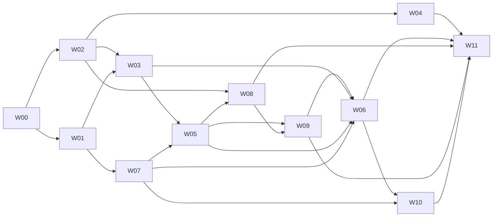

# Local-first LLM wiki model routing, validation and Goal execution plan — 2026-10-08

Status: execution contract, with a local-first policy revision and a separate
[implementation status record](../research/2026-10-09-llm-wiki-execution-status.md).
The original planning baseline is `4b7ca1ab49cf15f0159be5a19db7d11c434d69fb`,
myco 0.4.0. Candidate assignments below are evaluation proposals, not accepted
models or claims of installed-app quality. Code, actual-model and installed
verification have separate milestones.
It operationalizes the [18 findings and 11 work packages](../research/2026-10-08-llm-wiki-audit.md).
The target machine is an ARM64 Mac with 16 GiB unified memory.
Policy revision: the user's local-first instruction supersedes the earlier
connected-generator defaults. External API/CLI inference is an optional user
choice; it is not a requirement for core functionality or release acceptance.

## Decisions and scope

1. Repair deterministic preservation, isolation and publication rules first.
   Models return evidence-bound proposals; the application owns every mutation.
2. Deliver all core wiki workflows with **on-device models and deterministic
   code**, without external accounts, API keys, subscriptions or connected CLIs.
   **Gemma 4 E4B instruction-tuned QAT Q4_0 GGUF** is the first local quality
   candidate. It is not yet accepted, integrated or selected in the installed app.
3. Keep **BM25 + E5-small-ko + RRF** as the retrieval control. Evaluate
   **EmbeddingGemma 2 text Q8_0, 768d** first; replace E5 only after separate
   retrieval, clustering, runtime and migration gates pass.
4. Use existing **Qwen3.5 4B** as a failing local control. **Gemma 4 E2B** and
   existing **Qwen3.5 2B** are resource/light-extraction challengers, evaluated
   per role before adoption. The previously tested Qwen 9B is not accepted.
5. Test actual generation separately from mocked orchestration and installed UI.
   Preserve failures and missing evidence rather than reporting global success.
6. Reuse the wiki, canonical session summaries, topic maps, queue and hybrid
   retrieval. A new graph database, full GraphRAG replacement, model training,
   autonomous task execution and a new OCR feature are outside the core Goal.

The original planning document did not start a Goal. The active implementation
uses the work packages and completion criteria below; progress is recorded
separately. The product default is local even
if credentials or an external CLI are detected. The user must both connect and
select an external route for the relevant operation before it may be used.

## Local-first product contract

- Default generation, embedding, transcription, continuous organization and
  supported learning/Agent proposal flows run locally. Local artifact download
  or offline file import is distinct from inference; explain size/license/source
  before a requested download and verify revision/SHA. Queries and vault content
  are not sent with model downloads. After artifacts are prepared, core local
  workflows must run with external network access disabled.
- External APIs and cloud-backed CLIs are optional. Connecting/authenticating,
  discovering a catalog and selecting a per-role route are separate states.
  Detection or connection alone never changes local defaults or submits content.
- Local failure, low confidence, OOM, delay, missing weights or insufficient
  context never triggers remote inference, a paid judge or another provider.
  Offer local retry/model installation/settings and preserve pending work. An
  external route is used only through the user's explicit selection.
- Snapshot route/model/vault/source revision when a job starts. Background work
  uses local defaults unless the user has explicitly selected and enabled that
  external role for automatic execution. Connection restoration alone does not
  resend failed paid jobs. Switching/disconnecting cancels owned work where
  possible and rejects stale publication; disclose unsupported remote cancellation.
- Optional external usage shows the provider, data scope and known cost/usage.
  Unknown estimates remain unknown; do not represent CLI subscription usage as
  free API tokens. No paid upsell, account requirement or connection prompt is a
  prerequisite for core local tasks or a substitute for fixing local quality.
- Source imports or updates may need their own user-requested network action.
  This is separate from remote model inference; an offline core test uses local
  files and blocks network. Loopback MCP is not a cloud provider.

These are implementation requirements, not assertions that today's app already
satisfies them. Existing external integrations remain optional supported choices.

## Product model assignment

The initial evaluation generator is **Gemma 4 E4B**. Use verified non-thinking
structured generation first; compare bounded thinking separately for advice,
conflicts and planning. Gemma's controls are not Sol-style low/medium/high
efforts. Freeze templates, sampling and task schemas before comparison. A smaller
local model upgrade is per role, not global, and cannot weaken semantic gates.

| Product operation | Initial route and output | Comparison or promotion rule |
| --- | --- | --- |
| Save/read/delete, raw protection, CAS, undo, ledger and vault isolation | **No LLM.** Canonical paths, ownership, hashes and origin opening token. | Fault tests are the gate. Model importance scores never authorize deletion; existing user-directed eligible non-raw deletion policy stays separate from raw immutability. |
| Session identity, revisions, dedup and queue | **No LLM.** Stable `session_key`, source SHA and exact revision receipts. | Same-session extension must update one canonical page without losing human title or annotations. |
| Harvest, junk/size admission, TTL and quarantine | **Deterministic rules + E5** for similarity candidates. | Compare candidate precision with EmbeddingGemma 2; no model-only irreversible cleanup decision. |
| Generated session title, project/entity candidates and tags | **Gemma 4 E4B, non-thinking candidate.** Grounded candidates; human title remains authoritative. | Gemma E2B/Qwen 2B can replace only this role after its title/entity evaluation passes. |
| Requests, plans, decisions, reports and outcomes | **Gemma 4 E4B candidate.** Structured claims with actor, event time, speech act and evidence. | Smaller models get a separate claim-extraction trial; title success does not qualify them. |
| Incremental session summary | **Gemma 4 E4B candidate.** Claims first, then owned-section summary; exact source revision. | Qwen 4B failing control; bounded chunk/claim batches, incremental revision updates and publication only after validation. |
| Project pages, digest, weekly/monthly rollup | **Gemma 4 E4B candidate.** Hierarchical grouped claims with original-source lineage and coverage receipt. | Compare non-thinking/bounded thinking at fixed budgets; model-produced summaries are not independent evidence. |
| Ordinary Ask and recent-work summary | **Gemma 4 E4B candidate.** Answer claims and source references under the same scope/date contract. | Compare Qwen 4B control; quotations or inventory counts alone do not pass a summary request. |
| Next-work advice and priorities | **Gemma 4 E4B candidate.** Facts, unknowns and proposed actions are distinct. | Bounded thinking is a separate local experiment; smaller local models need the same critical advice gates. |
| Intent and ambiguous “recent” period | **Gemma 4 E4B candidate.** Chosen interval and rationale from query time, timezone and bounded date metadata. | E2B/2B role-specific comparison. Explicit dates override inference; no universal seven-day default. Display the inferred range. |
| Exact/semantic search, scope/date filtering and citation lookup | **BM25 + E5-small-ko + RRF**, deterministic filtering. | **EmbeddingGemma 2** search/document prefixes; **Qwen3-Embedding-0.6B** is the alternate challenger if warranted. |
| Reranking | **Disabled initially.** Retain hybrid ranking control. | **Qwen3-Reranker-0.6B**, only after candidate compatibility and measurable retrieval/end-answer gain. |
| Clusters, related links, ontology and resurface similarity | **E5 + deterministic policies.** Approved anchors and model-specific calibration. | EmbeddingGemma 2 **clustering** prefix has a separate representation signature from search. |
| Topic map/MOC explanation and refresh | **Gemma 4 E4B candidate.** Approved member revisions and bounded evidence packets. | Refresh owned sections while preserving human text; smaller-model promotion needs map-specific evaluation. |
| Reflect/lint | **Code** for links, structure and paths; **Gemma 4 E4B candidate** for opt-in local semantic proposals. | Local bounded-thinking comparison for contradictions. A finding is a proposal, not truth or write authorization. |
| Study/cards/quizzes | **Extractive + FSRS** default; **Gemma 4 E4B candidate** for opt-in local generated content. | E2B/2B role-specific trial; question, correct answer and distractor explanations need evidence. |
| Resurface selection and feedback | **E5 + deterministic dormancy/impression policy**; optional local E4B reason. | EmbeddingGemma 2 comparison; one acceptance per impression and model-bound calibration. |
| Agent planning and proposed edits | **Gemma 4 E4B candidate.** Bounded operation schema, preview and expected revisions. | Local bounded-thinking comparison. Checked native executor applies approved operations; no external CLI prerequisite. |
| Tasks, recurrence and schedules | **Code** for dates/recurrence/state; local E4B for natural-language proposals. | E2B/2B comparison. No unattended execution of every inferred task. |
| Audio transcription | Existing **Whisper small q5_1** baseline, with pinned revision/SHA added. | **Whisper turbo** is a later Korean transcription challenger, separate from text-answer quality. |
| Audio summary script | **Local Gemma 4 E4B candidate** over verified transcript/note text; installed local TTS voices for offline playback. | Ground script claims in transcript spans. If no verified local voice exists, retain text-only output; no remote voice fallback or unsolicited voice download. |
| Image understanding | **Optional later local multimodal extension.** Text-model integration does not establish image support. | No invented image descriptions; actual encoder/attachment/runtime tests are required. External vision remains a separate user-selected option. |
| Digital PDF/document extraction | **No LLM.** Existing parsers with explicit failure/truncation results. | Scanned PDF OCR remains unsupported in the core Goal. Apple Vision is a later extension requiring its own OS/language/accuracy evaluation. |
| Evaluation | **Deterministic gold labels + original-source review**, no external model required. | Local model judging may help triage after calibration; it cannot grade its own output into acceptance. Any external judge is separately opted in and never a core gate. |

The first artifact candidate is Google's
[official E4B instruction QAT Q4_0 GGUF](https://huggingface.co/google/gemma-4-E4B-it-qat-q4_0-gguf).
The isolated [candidate artifact record](../../src-tauri/eval/local-model-artifacts.json)
pins the publisher's revision, filename, declared size and SHA, checked October
9, 2026. Its E4B text weight is 5,154,941,280 bytes (5.15 GB decimal); this is disk
size, not measured memory usage. No weight download, local checksum, runtime
conformance or semantic acceptance is established by that metadata record.
Preflight must verify the downloaded bytes, license and runtime before inference.
The app manifest currently accepts Qwen 2B/4B only; `gemma4` architecture
registration alone is insufficient. Add verified template/control-token/EOG,
sampling and structured-output support before claiming app compatibility.

Current local request support is 2048/4096 context tokens and 1–768 output tokens.
Do not advertise the vendor's 128K capability as current app support. Compile
chunk→claim→session→project/time summaries with original lineage, resolve state
using bounded retrieval and reuse completed revisions. Longer contexts require
a separate resource and quality experiment, not whole-vault prompt dumping.

### Optional external model choices

Only a connected **and explicitly selected** route can use these candidates.
No optional comparison, paid call, cloud judge or account is needed to finish
the local acceptance plan. A better external score never changes the default.

| Optional route | User-selected role and compatibility work |
| --- | --- |
| GPT-6.1 Sol | Optional general extraction/summary/Ask route; use documented per-task effort/schema only after adapter validation. |
| GPT-6 Astra | Optional complex advice/planning or evaluation triage; no automatic escalation from local failures. |
| GPT-6 Luna | Optional high-volume extraction candidate, separately evaluated per role. |
| Claude Sonnet/Haiku/Opus 5.5 | Optional generation/extraction/reference comparisons where supported; validate schema/citation compatibility. |
| Gemini 3.8 Flash / 3.5 Flash-Lite | Optional generation/extraction routes; update capabilities and thinking/schema support before exposing them as supported. |

If a selected external route is unavailable, preserve its explicit failure state.
Do not retry through a different provider or silently bill the user. Local work
and local release acceptance continue without external credentials.

## Execution and evidence contract

### Local execution and optional connected runners

- Make the in-process local generator the default for all supported semantic
  roles. App-owned schemas/evidence publication remain provider-independent.
  Schedule one generator at a time, prioritize interactive queries over bounded
  background compilation and retain retryable queue state after interruption.
- For the optional Codex path, use the installed CLI's
  supported structured-output/read-only/ephemeral controls. The present bridge's
  workspace-write run inside the user's vault must not be reused for read-only
  generation. Evidence packets are app-selected and revision-bound.
- Read-only sandbox is not complete read/network/connector confinement. Control
  inherited settings, hooks, MCP/apps and filesystem reach; verify the boundary
  using sentinel files and injected instructions. Do not claim isolation from
  the flag alone. Provider-owned writes never publish directly into the vault.
- Use app-owned operation execution for Agent edits. Source text is untrusted
  evidence, not instructions to widen tools, scopes or mutation capabilities.
- Optional direct OpenAI tool calls need a Responses adapter for Sol/Astra.
  Plain text Chat Completions and tool use are separate tests. Do not send
  unsupported `none`/`minimal`, or sampling fields incompatible with reasoning.
  CLI effort discovery and API effort lists are separate contracts.
- Pin local weights by immutable revision, size and SHA; verify template,
  tokenizer, pooling, output accessor and supported context before scoring.
  Use one local generator at a time on this machine. Never infer memory usage
  from a GGUF file's size or an effective parameter label.
- Compilation output carries `derived_from` lineage. Import/evaluation filtering
  and optional CLI ephemeral runs keep compiler/evaluation runs from becoming
  independent source evidence or recursively inflating the wiki through import.

### Shared typed fields

| Object | Required application-owned or model-proposed fields |
| --- | --- |
| Evidence snapshot | App-owned `vault_id`, `opening_generation`, source kind/path, `session_key` where applicable, source SHA/revision, evidence ID, original span, speaker and recorded time with precision. |
| Claim | Model-proposed actor, event time/precision, `request/plan/report/verification/retraction/question`, status, evidence IDs and uncertainty. Assistant report and independently evidenced verification are distinct. |
| Compilation | Claims, generated title/entities, owned-section summary, unresolved state and source lineage. App computes processed/eligible/used/omitted counts and checks exact revision before publication. |
| Answer | Supported factual claims, rendered answer, evidence references and unknowns. Recommendations separately contain action, rationale, supporting facts and dependency/inference labels. |
| Proposal | Origin vault/opening token, permitted operations, exact expected hashes and preview. Native execution rechecks origin/CAS and raw confinement after approval. |
| Outcome | `success/partial/failed/stopped/skipped/pending/unavailable`, item/step result, retry disposition and receipt. Provider cancellation, discarded late output and actual child termination are distinct. |

Validate IDs, revisions, scope, spans, dates and operation permissions in code.
Schema conformity alone cannot prove actor/status interpretation or entailment.
Reject invalid publications and retain retryable source/queue state. One bounded
schema repair by the selected local model is the initial proposal; no unlimited
retry, silent smaller-model fallback or external repair/judge loop.

For ambiguous periods, the planner sees bounded date metadata, not the entire
transcript archive. An explicit historical as-of date excludes future outcomes.
For a current-state question, bounded resolution retrieval may inspect newer
same-scope completion/retraction records up to query time; expose its interval
and distinguish it from the requested activity period. Never silently broaden
the selected vault/scope or treat missing later evidence as current noncompletion.

## Evaluation corpus and comparison procedure

The [v1 synthetic reference corpus](../../src-tauri/eval/local-wiki-v1/README.md)
now freezes these counts, project splits and source hashes. Its integrity runner
does not execute production retrieval, compilation, inference or offline/native
scenarios. Labels are synthetic references and still require original-source
review before semantic release acceptance. Build the evaluation around 20
synthetic projects with three independent session timelines each:
**60 timeline families**, each with at least three source revisions. Include
requests, assistant reports, verification, retraction/rollback/reopening,
priority changes, actor ambiguity, repeated boilerplate and injected instructions.
Record event time separately from import/file modification time.

Split by project **8 development / 4 calibration / 8 held-out**, corresponding
to 24/12/24 timelines. Every revision and query variant of a project stays in
one split. Assign six positive and three negative retrieval queries to each
project; negative variants stay in the same project split. Freeze labels,
allowed facts and critical omissions before inference.
Existing 62-query/15-negative retrieval fixtures and published generation probes
are development/regression cases, not new unseen held-out data.

| Suite derived from the projects | Frozen reference total | Final held-out |
| --- | --- | --- |
| Retrieval | 120 positive + 60 negative queries | 48 positive + 24 negative |
| Ask/advice | 60 timeline + 20 broad project questions | 24 timeline + 8 broad |
| Compilation/maps | 60 session + 20 project/map cases | 24 session + 8 project/map |
| Study/resurface | Two grounded card cases per project plus impression events | Eight held-out projects; derived cases are not independent corpus evidence |

Include all/wiki/sessions/one-note scopes, equivalent dated/undated requests,
local midnight and DST, unavailable folders, long-session tails and unlinked
pages. Put important completion/retraction/rollback evidence beyond the first
top-K and initial context. Include a case with no resolution: the correct current
status is unknown. Process chatter must not replace the person's actual work.

1. **Compatibility smoke:** tiny synthetic input per candidate. Verify model
   access, schema/refusal/cancel, template, pooling, finite output, dimensions,
   normalization and prefixes. Failing candidates do not enter a bakeoff.
2. **Development screening:** use the 24 dev timelines for title/entity/claim
   extraction and session summaries, a stratified 24 questions from the 32-case
   dev Ask pool, eight dev projects for maps/period planning and 16 dev Study
   card cases. Record a role-specific manifest; variants are not independent
   families. Score title/entities/claims separately from one structured result
   when possible to avoid redundant calls. At most two finalists per role
   proceed. Use calibration only for thresholds; generation quality is not
   tuned on held-out output. Local candidates run the eight designated difficult
   state cases. External reference runs, if separately selected, are optional
   and never substitute for failed local results.
3. **Held-out comparison:** finalists run the above held-out suite. For eight
   critical state cases, repeat inference three times and retain each failure;
   repetitions do not count as new independent cases.
4. **Factor isolation:** first compare generators on identical eligible evidence
   with the current E5 retriever. Then compare embeddings with the accepted
   generator fixed. Finally test the combined pipeline. Keep chunking/RRF fixed
   when changing embeddings; metadata context, grouping, dimension reduction
   and reranking are separate ablations.
5. **Review:** deterministic scenario labels and original-source comparison
   decide factual support. An independent reviewer checks all critical outputs;
   label an agent/model review as automated, never human-reviewed. Human review,
   when actually performed, has its own receipt. Any local or explicitly selected
   external judge is triage only; blind names/order and inspect disagreements
   with source evidence. Same-family models are not independent ground truth.
6. **Freeze and promote:** choose a per-role winner only after gates. If held-out
   failures lead to prompt/threshold tuning, that version becomes regression data;
   obtain new project families for a new final acceptance run. Rejecting a new
   model and retaining the validated control is a valid evaluation outcome.

### Fixed comparison tracks

| Track | Proposed budget and comparison boundary |
| --- | --- |
| Shared | Identical frozen evidence text/order, at most **2048 evidence tokens / 768 visible-answer tokens**. Actual tokenizers must fit system/schema/question/citation metadata and safety margin into the weakest tested **4096-token** context; refuse an oversized fixture instead of silently dropping evidence. |
| Extended, optional | Identical evidence text/order, at most **12000 evidence tokens / 3072 visible-answer tokens**. This requires a separately implemented and verified local context/output extension; it is not currently supported. Only candidates with context/template/memory fit of at least approximately 16K participate. Keep scores separate from Shared; core local acceptance does not require this extension. |
| Reasoning/provider limits | Freeze local thinking mode, decoding/sampling and actual total generation limits. Equal visible output does not mean equal reasoning compute. For optional API/CLI runs, record documented effort and limits separately; API limits include non-visible tokens and CLI unsupported ceilings remain requested/unknown. |

Token counts differ across tokenizers. Freeze the packet using a common maximum
token-count fit, then keep its text unchanged across candidates. Visible length
is app-validated; a prompt request or post-generation rejection is not a provider
hard billing cap. Final extraction schemas may require a separate fixed output
track, frozen before inference and reported separately from prose answers. Until
local output limits are extended and validated, split extraction into bounded
atomic claim batches that fit 1–768 tokens; retain original span/revision coverage.

## Tests and acceptance gates

These are proposed product thresholds, to freeze before candidate measurements.
They are not vendor guarantees or statistically established production accuracy.

| Layer | Required test and passing evidence |
| --- | --- |
| Preservation/isolation | Root/child read denial, partial scan/stat failure, source symlinks, external targets, A→B/same-path reopen, concurrent editor/MCP/import/clip, approval race, interrupted publication and injection. **Zero** unintended raw/human-content loss or cross-vault writes. Any failure blocks release. |
| Workflow truth | Fail provider/validator/CAS/archive/ledger independently. Pending/partial/failure remains visible and retryable; no failed success watermark. Undo after human edits rejects; draft recovery survives restart. |
| Structured publication | Every accepted result passes schema, permitted source IDs, scope, revision and origin checks (**100%**). Invalid output is rejected, not converted into a successful answer. |
| Critical meaning | **Zero** invented critical actor/status/date/verification and **zero** missed required completion/retraction/rollback facts in the reviewed release cases, including repeats. Historical unknown remains unknown unless later evidence resolves it. |
| General meaning | Proposed held-out supported-claim precision **≥98%**, important-fact coverage **≥90%**. Log every unsupported claim/omission and denominator. A mean cannot hide a critical failure. |
| Answer usefulness | **≥90%** of cases score at least 3/4: correct task response, useful grouped explanation/action, relevant reason/evidence, appropriate uncertainty. A quote list or total item count fails a requested summary/advice case. |
| Smaller local model promotion | E2B/Qwen 2B must preserve all critical cases for the proposed role, with no more than **2 percentage points** loss in noncritical role score against the accepted quality model, plus measured latency/memory gain. Report small-sample uncertainty; title success does not qualify claim generation. |
| Retrieval promotion | State-resolution/scope regressions **0**. Prefer ≥5 percentage points Recall@10 or ≥0.03 nDCG@10 gain over the current hybrid on the new suite, with no unexplained >2-point KO/long-tail slice regression. Publish paired cases and project-level uncertainty; small slices cannot establish significance. Equivalent quality with lower resource cost needs a separately documented tradeoff. |
| Abstention | Report negative false acceptance and positive false rejection at calibration-frozen thresholds. Initial goal: no critical wrong-scope acceptance and ≤5% ordinary negative false acceptance on held-out. With 24 negatives, disclose counts/intervals rather than claiming population 0%. |
| Clustering/maps | Pair labels plus member/anchor status/revision cases. Approved anchors only, thresholds in the chosen geometry, no mixed model/signatures, human annotations unchanged and new members reflected. Retrieval gains do not automatically qualify clustering. |
| Local execution | Actual on-device schema/template/context, unload/load failure, truncation, OOM, Stop/restart and queued-background contention. No silent model/cloud replacement or late publication. Core acceptance needs no external authentication. |
| Optional provider/CLI | Local wiremock/selection tests cover refusal, truncation, 429, credentials/quota/network failure, retry/disconnect and Stop. Actual authenticated inference is an opt-in connector receipt, not a core gate. Unknown cost stays unknown. |
| No-account/offline core | After artifact preparation, block external egress for the native app/children and use an isolated QA profile/environment exposing no provider accounts/API keys/external CLIs. Run all supported core workflows; repeat with synthetic saved credentials and local mode. Remote inference, repair/judge, catalog/telemetry and unsolicited download attempts **0**; record attempts separately from blocked/successful calls. |
| Study/resurface/media | Correct grounded answer/explanation, no unsupported option relationships; one acceptance per impression and model-bound calibration. Transcription evaluates Korean errors/timestamps separately. Unsupported PDF/OCR/modality remains explicit. |
| Installed acceptance | Actual native app + fixture vault in local/no-account/offline mode: import→revision compilation→search→answer→original source, stop/retry/restart, vault switch and unreadable recovery. Cover supported local maps/Reflect/Study/Agent proposals too. Source hashes and UI evidence must agree. Mocked UI or helpers cannot satisfy this gate. |

Mandatory reviewed adversarial cases require support for every factual claim;
the general 98% threshold is an aggregate screening target, not permission to
publish a known false claim. If needed facts are unavailable, give an honest
insufficient-evidence result. Keep source quotations visibly separate from a
completed generated answer.

Usefulness/coverage denominators include every scheduled case. Unavailable,
refused, truncated and failed runs do not disappear from the comparison. Correct
insufficient-evidence responses in labeled negative cases are accepted abstention,
reported separately. Claim precision uses its claim denominator, alongside the
full-case success/abstention/failure counts so empty output cannot look perfect.

The offline suite also covers first-run local installation guidance, corrupt or
missing weights, interval planning/schema repair, automatic session sweeps,
standalone Python ingest/digest, local media and source-content sentinels.
Transcription uses prepared local Whisper weights;
playback uses verified installed local voices, or text-only output if unavailable.
Do not delete real user credentials, disconnect their accounts or uninstall
tools for test isolation. The saved-credential variant uses synthetic credentials
and local wiremock endpoints, not copies of real secrets. Inspect native HTTP,
background jobs and owned child processes, not renderer routing mocks alone.
Use isolated app/process egress
controls and a documented loopback allowlist; separate test-harness traffic.
Requested downloads/source imports/updates have distinct network purposes and
stay disabled in this suite. Verify no private content is sent by metadata,
telemetry, pricing, hidden evaluation or fallback paths.

Connector lifecycle tests require that connecting alone preserves local routing;
external selection snapshots role/model/scope, disconnect prevents new calls,
late results cannot publish, and restart/retry cannot silently choose another
provider or resume billing. Store secrets separately and redact diagnostic logs.

## Existing harnesses and new test work

| Test class | Reuse and required extension |
| --- | --- |
| Frontend unit/state | Existing Vitest storage, evidenceWrite, sessionNote, queryStore/queryActivity/querySynthesis, ingest/distill/maps/Reflect, provider/budget/chat and Study/resurface tests. Add failing regression cases before fixes; preserve existing expectations except when correcting an explicitly documented wrong contract. |
| Native filesystem tests | Existing Rust helpers and temp-vault tests. Add fault injection and concurrency barriers; helper-only `vault_lifecycle` tests do not establish public IPC/MCP capabilities. |
| Native/transport integration | **New required coverage:** actual checked command dispatch and exposed MCP transport/tools against temporary vaults. Exercise every legacy/new writer and origin token, not merely the path helper. |
| Provider integration | Required routing/disconnect/zero-egress checks and existing local wiremock adapter tests; optional Responses/structured/refusal/cancel contracts for exposed connected routes. No real paid call is needed for these tests. Wiremock success is not account/model-quality proof. |
| Browser interaction | Existing `test:e2e:*` Playwright scripts use synthetic IPC. Extend affected workflows and test 375/768/1280 px plus keyboard/state recovery. Report these as mock-IPC browser UI checks. |
| Actual model inference | Extend production-prompt native probes into manifest-driven **local** synthetic replay. Any connected-runner comparison is a separate opt-in suite. Keep private corpus explicit; no implicit actual-user-folder fallback. |
| Offline/process egress | New required native/app-child integration suite, with no external credentials/CLIs and then saved credentials in local mode. Exercise auto import/Python/repair/planner/judge paths; record attempted, blocked and successful network operations by purpose without source text. |
| Native UI | Separate bundle ID/isolated app data and synthetic vault per [signing guide](../../../docs/SIGNING.md#local-builds-and-macos-folder-permissions). Final authorized installed verification uses a stable identity and records bundle/commit hashes; do not run ad-hoc QA copies against the active user vault. |

Verified existing commands, to execute during the appropriate Goal gates:

```sh
# app/
npm run lint
npx tsc -b
npx vitest run
npm run build
npm run test:e2e:ask-lifecycle
npm run test:e2e:import
npm run test:e2e:agent
npm run test:e2e:harvest
npm run test:e2e:reindex
npm run build:macos:signed -- --check

# app/src-tauri/
cargo fmt --check
cargo clippy --all-targets -- -D warnings
cargo test
MYCO_EMBED_SPEC=e5-small-ko cargo run --example retrieval_eval --release
```

The existing retrieval example defaults to old `gemma`; use the explicit current
E5 ID. Historical `MEMEX_*` examples are not the current harness interface.
`bench_embed` falls back to real Memex sessions: first add a required explicit
fixture path/no-private-fallback contract before using it for public evaluation.
Actual MCP HTTP transport regressions and the W00 fixture integrity runner now
exist; their executed scope is in the status record. Actual-model replay,
native UI and process-egress suites still need implementation. This document
invents no executable command or nonexistent model-registry entry for them.
The signed-build `--check` is a read-only identity preflight, not installed or
notarization acceptance. Do not run `cargo test -- --ignored` indiscriminately:
inspect each named ignored test's filesystem/keychain/credential/model effects,
isolate it and record any unexecuted scope.

## Latency, resources, cost and receipts

Collect timing instrumentation early in W00/W08, not only after model selection.
For each finalist and representative evidence-size bucket, target five cold and
20 warm observations, with generation/indexing isolated. Also test one realistic
contention scenario. Record model load, planning, retrieval, prefill/decode when
available, validation, publication and total time; unavailable stages stay unknown.

Persist comparable completed samples by model/role/evidence bucket/cold-warm.
At **n≥10**, show observed mean, median/range and sample count rather than an
invented ETA. Below that show elapsed time and insufficient samples. p95 may be
shown as descriptive at a larger sample, such as n≥100, with counts; do not claim
an SLA or hide failed/cancelled attempts. Keep failure/retry/cancel distributions
separate and visible. Estimate the remaining work only after a compatibility/dev
pilot using measured throughput, startup costs, planned cases/repeats and retries.
Preserve the removal of arbitrary local Ask deadlines. An isolated test watchdog
may stop and record a failed run; it must not become a product answer time limit.
Provider/transport ceilings remain explicit and distinct from manual Stop and
measured expected duration.

Record app/child peak RSS or physical footprint when available, system memory
pressure and swap growth. Metal/unified memory is not fully represented by one
RSS number. Stop a local trial on OOM/critical pressure; unload it before trying
another. Freeze and document the resource tradeoff instead of downgrading models
silently. Exact memory/time caps require baseline measurements.

Local acceptance measures throughput, latency, memory and artifact disk size;
it incurs no remote LLM usage charge and does not require provider-price fetching.
Hardware/energy/bandwidth costs are not claimed to be zero. For **optional opted-in
external runs**, record dated prices/usage, retries/reasoning/tool costs where
exposed and cost per accepted answer. API cost and CLI subscription usage are
different; missing values are unknown. Establish the permitted calls/budget before
paid evaluation. Absence of this optional budget never blocks local evaluation.

Each package and inference run stores:

- Commit/build/bundle hash, command and exit result; dataset/split/label hashes.
- Model ID/revision/weight SHA/quantization, runtime/template/pooling/prefix/dim,
  prompt/schema hashes, supported provider effort/options and token budgets.
- Hardware/OS, cold/warm state, evidence/source hashes, scope/date resolution,
  raw output, acceptance/rejection reason and case-level semantic disposition.
- Timing/resource/cost observations, retry/cancel details, original/output file
  hashes and before/after human-owned bytes for mutation tests.
- Local/external route snapshot, connection versus per-role selection state,
  download versus inference purpose, offline/egress-denied test configuration and
  attempted/blocked/successful request counts. No external cost field is required
  to produce a complete local receipt.

Use a proposed isolated evaluation output directory outside the user vault;
public sanitized summaries may be committed, private raw output stays private.
Record actual artifact locations when created. Do not cite a temporary harness
that was cleaned up as a durable receipt. A hash proves identity, not semantics.

## Goal work packages and dependencies

The coordinator owns contracts and sequential publication; independent workers
own storage/import, retrieval/provider, and organization/UI modules. Avoid parallel
edits to the same file, competing index publishers, simultaneous local benchmarks
or independent changes to a frozen evaluation set. Product routing above does
not prescribe or pretend to change the current Codex implementation-agent model.
Record the actual implementation/review model if available; unavailable metadata
stays unknown. Use independent review and reproducible tests for code completion.

| Package / model | Dependencies | Deliverables and completion receipt |
| --- | --- | --- |
| **W00 — Preflight and evaluation contract / no product LLM** | None | Inventory entry points, local artifact/runtime support, golden regressions, split manifest, temp-vault/no-account/offline isolation, receipts and timing hooks. Add failing critical tests; catalog/account discovery is not a prerequisite. |
| **W01 — Read/scan preservation / no LLM** | W00 | Complete/partial/unreadable/missing states and same-vault index retention. Fault tests plus actual native dispatch recover without uncertain pruning. |
| **W02 — Mutation and execution boundary / no LLM for enforcement** | W00 | Canonical raw/path confinement, origin token, editor/MCP/Agent CAS and dedicated read-only generation runner. Actual transport/command negative tests and approval/vault races preserve sentinels and both edits. |
| **W03 — Continuous imports / code + local E4B candidate** | W01, W02 | Atomic shared ledger, projection annotation ownership, visible import outcomes, exact-revision queue and lineage/dedup. Synthetic repeat/extension/restart/concurrency passes offline. Large private backlog compilation waits for W05/W09; plumbing can complete first. |
| **W04 — Honest outcomes/recovery / no enforcement LLM** | W02 | Structured step statuses, correct watermarks/cooldowns, durable drafts, hash-bound undo, bounded Git children/correct staged paths, Python automation routed through checked behavior. Every injected partial failure retains source backing. |
| **W05 — Claims and activity recall / local E4B candidate** | W03, W07 | Shared claim schema, local period planner, scoped dated/undated route and bounded state-resolution retrieval. Regression cases pass source/date/actor/status checks without cloud reference; quotes/counts cannot be successful advice. |
| **W06 — Organization/maps / E5 + accepted local generator** | W03, W05, W07, W09 | Approved anchor geometry/calibration, revision-bound cache and map owned-section refresh. Member/status/same-count edits preserve annotations; local grounded descriptions pass organization cases. |
| **W07 — Index publisher and coverage / BM25 + E5** | W01 | One publisher/shared generation, watch topology, unlinked inventory and revision-key query caches. Barrier rebuild/edit tests and source hashes prove lexical/dense consistency. Coverage counts distinguish scanned/eligible/selected/used. |
| **W08 — Local execution/selection/cancel/resources** | W02; W05 for final integration | Local manifest/template/schema/role routing, download/inference separation, interactive/background scheduling, stage timing and actual cancellation. No-account/offline/saved-credential tests; connecting never changes defaults. Exposed optional connector guards use local wire tests, not mandatory authenticated calls. |
| **W09 — Local generator selection / Gemma E4B vs Qwen 4B; E2B/2B per role** | W05, W08 | Local smoke→declared dev screening→at most two finalists→held-out source review. Freeze accepted model/thinking/template/schema per role with rejection and resource receipts. If all local models fail, useful local generation remains incomplete; external success cannot satisfy it. |
| **W10 — Embeddings/rerank / E5 vs EmbeddingGemma 2, conditional Qwen** | W06, W07 | Runtime/output accessor verification, reference vectors, search/clustering ablations, migration of dense/quarantine/ontology/distill/resurface state and rollback. Shadow index first; no mixed dimensions/signatures or raw changes. Reranker stays off without gain. |
| **W11 — Learning/feedback and local release / accepted local models** | W04, W06, W08–W10 | Local grounded Study, resurface, pinned transcription, timing UI and affected states. Full required code/offline gates, isolated native UI and stable local installed-app verification. README describes actual local defaults and opt-in external support; no account/paid judge prerequisite. |

Optional **O01** covers user-selected external adapter/capability/discovery/cost
work beyond the required routing/security guards; optional **O02** covers actual
connected generation/judge comparisons. O01 follows W02/W05/W08 and O02 follows
O01 plus explicit route/data/budget selection. Neither is a predecessor of W09
or W11. For an existing connector exposed in the release, its selection/security
and truthful capability tests remain required; unavailable live evaluation is
reported for that optional connector, not hidden as verified support.

W01 and W02 can run in parallel. W07 follows W01 while import/recovery work
proceeds. W08 can implement capability/cancellation while W05's schema is being
designed, but final integration waits for that schema. W09 finishes before maps
are evaluated/promoted; W10 does not confound generator selection.

The graph shows required local work only; O01/O02 are optional branches.



## Failure, rollback and Goal completion

Use package states `planned/in_progress/implemented/verified/blocked/rejected`.
Store exact remaining work at every continuation. Implementation, model acceptance
and installed acceptance are different milestones. Never mark the whole Goal
complete because unit tests pass, the build succeeds or the budget is nearly spent.
Package blockers do not automatically block the Goal. Pause only on explicit
user request. Mark Goal blocked only after the same condition recurs for at least
three consecutive Goal turns and no meaningful independent progress remains.

- A preservation/isolation failure stops publication immediately; independently
  safe work may continue. Preserve failing artifacts and add a regression before
  retrying. No unsupported source deletion or blanket trash-emptying rollback.
- Generate owned-section drafts from frozen sources. Publish with origin/CAS;
  retain prior content and source lineage. Rollback must verify hashes and never
  erase a later human edit. Index migration uses a shadow generation and an atomic
  switch only after validation; keep the validated old generation for rollback.
- A rejected EmbeddingGemma/reranker candidate can close its evaluation package
  with E5/hybrid retained and reasons. If no generator meets the useful-answer
  gate, W09 and the overall useful-answer objective remain incomplete.
- Missing optional external credentials/model access is `not_evaluated` for that
  optional route and does not block core work. Missing required local artifacts,
  runtime/quality, signing identity or native UI access is a concrete blocker for
  the affected mandatory package. Continue independent work and
  report the concrete missing condition. Do not bypass macOS permissions/TCC,
  fake screenshots, relaunch ad-hoc copies against the active vault or repeatedly
  ask for the same already-granted authorization.
- Reversible development/tests proceed within the Goal's scope. Local-first
  product defaults supersede detection-based external routing. An external call
  requires user connection plus explicit role/data/automatic-execution selection;
  existing implementation-agent access does not imply product selection. New
  paid account/endpoint use, private data transfer
  or public release requires the applicable explicit authorization; prepare a
  concrete reviewable result first. Do not treat future Goal wording as permission
  to silently enable unrelated providers or irreversible model-decided cleanup.

### Copyable Goal objective

> Implement and verify the myco LLM wiki plan W00–W11 in this document. Preserve
> immutable raw and human content, enforce vault/revision isolation, continuously
> compile admitted session revisions, unify scoped dated evidence and grounded
> useful **local** answers, and evaluate/promote on-device generators/embeddings
> only through the declared gates. After artifact preparation, pass no-account
> and offline core acceptance without paid APIs, connected CLIs or external model
> judges. Other models are optional only after user connection and explicit
> selection; local failure never silently escalates to cloud. Use isolated
> synthetic fixtures first. Finish with reproducible local receipts, actual
> native/installed verification within authorized scope, README updates and a
> truthful record of accepted/rejected candidates and remaining blockers. Do not
> substitute mocked UI or schema validity for actual semantic acceptance.

The objective deliberately has no invented token budget or completion-time
promise. Add a budget only when explicitly supplied. Overall completion requires
all mandatory preservation, queue, evidence, useful-generation and installed
gates, with every package accepted or explicitly resolved by a justified candidate
rejection. Useful generation must pass locally; externally generated success is
not an alternative. Optional external accounts/live tests/judges, OCR, new
frameworks and provider expansion are not required.

## Sources and planning receipt

Local and optional external model roles were checked against official sources on October 8, 2026:
[Sol](https://developers.openai.com/api/docs/models/gpt-6.1-sol),
[Astra](https://developers.openai.com/api/docs/models/gpt-6-astra),
[Luna](https://developers.openai.com/api/docs/models/gpt-6-luna),
[OpenAI parameter/tool rules](https://developers.openai.com/api/docs/guides/latest-model),
[Output-token accounting](https://developers.openai.com/api/docs/guides/token-counting#understand-output-token-counts),
[Codex exec](https://learn.chatgpt.com/docs/developer-commands#codex-exec),
[EmbeddingGemma 2](https://ai.google.dev/gemma/docs/embeddinggemma/model_card_2),
[Gemma 4](https://ai.google.dev/gemma/docs/core/model_card_4),
[Official E4B QAT GGUF](https://huggingface.co/google/gemma-4-E4B-it-qat-q4_0-gguf),
[Gemma 4 formatting/thinking](https://ai.google.dev/gemma/docs/core/prompt-formatting-gemma4),
[Qwen 2B](https://huggingface.co/Qwen/Qwen3.5-2B),
[Qwen reranker](https://huggingface.co/Qwen/Qwen3-Reranker-0.6B),
[Whisper](https://github.com/openai/whisper),
[Claude lineup](https://platform.claude.com/docs/en/models/overview),
[Gemini 3.8](https://ai.google.dev/gemini-api/docs/models/gemini-3.8-flash).
When an optional model judge is used, limitations and blinded comparison follow
[official evaluation guidance](https://developers.openai.com/api/docs/guides/evaluation-best-practices#llm-as-a-judge-and-model-graders);
the numeric gates and fixture sizes here are application proposals.

Original planning verification: read source audit, repository guide, manifests, current
test/retrieval examples and signing isolation contract; cross-reviewed routing,
evaluation design and dependencies. Installed CLI help/catalog was inspected
without inference. The local-first policy revision was cross-reviewed for model
feasibility, offline acceptance and optional-provider dependencies. No model
download, paid inference, app installation, user-vault
change, new test suite execution or Goal creation was performed for this plan.
README was unchanged for that planning-only revision. The subsequent source
boundary changes and README update are recorded separately in the implementation
status; they do not imply that W00–W11 or local model acceptance are complete.
